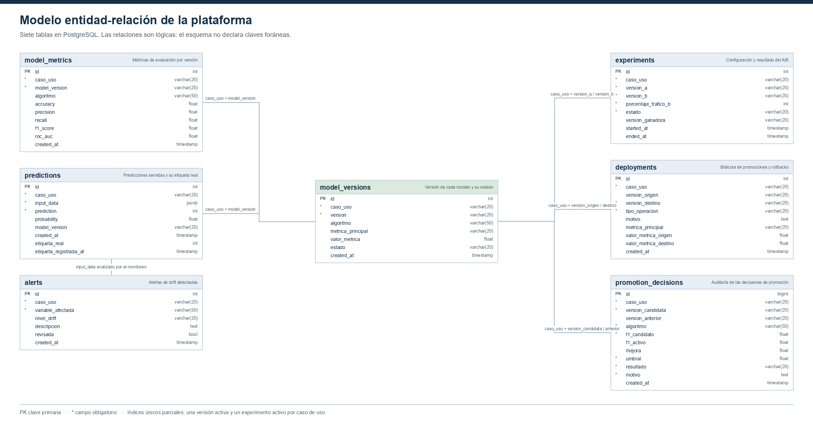

# S5-A3 — Modelo de datos de la plataforma

Issue #116. Describe el esquema de PostgreSQL en su estado final: qué guarda
cada tabla, con qué campos, cómo se relacionan y por qué la base de datos es
el punto de integración entre los componentes.



**Figura 25.** Modelo entidad-relación de la plataforma. Fuente: elaboración
propia. El diagrama lo genera `docs/figuras/sprint5/render_erd.py` leyendo
`information_schema` de la base creada con `schema.sql` y sus migraciones, de
modo que corresponde al esquema vigente por construcción.

## Son siete tablas, no seis

El enunciado del sprint habla de seis: las cuatro del Sprint 1 y las dos que
agregó S4-A1. A esas se sumó `promotion_decisions`, creada por S4-J2 en la
migración `002_promotion_decisions.sql` para auditar cada decisión de
promoción. El esquema vigente tiene siete.

## Las tablas

### model_versions — el registro del que todo cuelga

Qué versión de cada modelo existe y cuál está sirviendo en producción. Es la
tabla central: la API consulta aquí qué artefacto cargar, y el dashboard, el
A/B y el rollback se apoyan en su estado.

| Campo | Tipo | Propósito |
|---|---|---|
| `id` | int | Clave primaria |
| `caso_uso` | varchar(20) | `churn` o `fraude` |
| `version` | varchar(20) | Versión semántica del proyecto, por ejemplo `v1.3` |
| `algoritmo` | varchar(50) | Algoritmo que produjo el artefacto |
| `metrica_principal` | varchar(20) | Métrica con la que se decidió, `f1_score` |
| `valor_metrica` | float | Valor obtenido en esa métrica |
| `estado` | varchar(20) | `activa`, `historica` o `descartada` |
| `created_at` | timestamp | Momento del registro |

Un índice único parcial, `uq_model_versions_active_caso`, impide que exista
más de una versión `activa` por caso de uso. No es una convención que el
código deba respetar: la base la hace imposible de violar.

### model_metrics — el desempeño de cada versión

Las cinco métricas de evaluación de cada algoritmo en cada versión. Permite
comparar algoritmos entre sí y seguir la evolución a lo largo de las
versiones, que es lo que grafica el dashboard.

| Campo | Tipo | Propósito |
|---|---|---|
| `id` | int | Clave primaria |
| `caso_uso` | varchar(20) | Caso de uso |
| `model_version` | varchar(20) | Versión a la que pertenecen las métricas |
| `algoritmo` | varchar(50) | Algoritmo evaluado |
| `accuracy`, `precision`, `recall`, `f1_score`, `roc_auc` | float | Métricas de evaluación |
| `created_at` | timestamp | Momento del registro |

### predictions — lo que el sistema respondió

Cada predicción servida por la API, con los datos de entrada completos y, más
tarde, el resultado verdadero. Es la tabla que alimenta el monitoreo de drift
y la comparación de desempeño entre versiones.

| Campo | Tipo | Propósito |
|---|---|---|
| `id` | int | Clave primaria |
| `caso_uso` | varchar(20) | Caso de uso |
| `input_data` | jsonb | Datos de entrada tal como llegaron |
| `prediction` | int | Resultado del modelo, 0 o 1 |
| `probability` | float | Probabilidad asociada |
| `model_version` | varchar(20) | Versión que atendió la petición |
| `created_at` | timestamp | Momento de la predicción |
| `etiqueta_real` | int | Resultado verdadero, cuando se conoce |
| `etiqueta_registrada_at` | timestamp | Momento en que se conoció |

Guardar la entrada como `jsonb` evita que el esquema tenga que cambiar cuando
cambia el caso de uso: churn envía 19 variables y fraude 30, y ambas caben en
la misma columna sin alterar la tabla.

Las dos últimas columnas admiten nulos a propósito: al predecir, el resultado
real todavía no se conoce. La separación entre `created_at` y
`etiqueta_registrada_at` deja ver cuánto tardó en conocerse cada etiqueta.

### alerts — lo que el monitoreo detectó

Una fila por variable con drift detectado, con su nivel y la descripción que
incluye el PSI medido.

| Campo | Tipo | Propósito |
|---|---|---|
| `id` | int | Clave primaria |
| `caso_uso` | varchar(20) | Caso de uso |
| `variable_afectada` | varchar(50) | Variable donde se detectó el cambio |
| `nivel_drift` | varchar(20) | `bajo`, `medio` o `alto` |
| `descripcion` | text | Detalle, con el valor del PSI |
| `revisada` | bool | Si la alerta ya fue atendida |
| `created_at` | timestamp | Momento de la detección |

### experiments — la configuración del A/B

Qué dos versiones se comparan, con qué reparto de tráfico, en qué estado está
el experimento y cuál ganó. La API la consulta en cada petición para decidir
qué versión atiende.

| Campo | Tipo | Propósito |
|---|---|---|
| `id` | int | Clave primaria |
| `caso_uso` | varchar(20) | Caso de uso |
| `version_a` | varchar(20) | Versión de control |
| `version_b` | varchar(20) | Versión candidata |
| `porcentaje_trafico_b` | int | Reparto hacia la candidata, de 0 a 100 |
| `estado` | varchar(20) | `activo`, `finalizado` o `cancelado` |
| `version_ganadora` | varchar(20) | Resultado, al cerrar |
| `started_at`, `ended_at` | timestamp | Ventana del experimento |

Dos restricciones sostienen la lógica: un `CHECK` mantiene el porcentaje
entre 0 y 100, y el índice único parcial `idx_experiments_activo` admite un
solo experimento `activo` por caso de uso. La ventana de fechas es lo que
permite atribuir cada predicción al experimento correcto.

### deployments — la bitácora de producción

Cada cambio de versión en producción, con su motivo y las métricas de las dos
versiones involucradas. Es lo que permite reconstruir qué estuvo sirviendo y
por qué dejó de hacerlo.

| Campo | Tipo | Propósito |
|---|---|---|
| `id` | int | Clave primaria |
| `caso_uso` | varchar(20) | Caso de uso |
| `version_origen` | varchar(20) | Versión que salía, nula en la primera |
| `version_destino` | varchar(20) | Versión que entra |
| `tipo_operacion` | varchar(20) | `promocion` o `rollback` |
| `motivo` | text | Por qué se tomó la decisión |
| `metrica_principal` | varchar(20) | Métrica de la comparación |
| `valor_metrica_origen`, `valor_metrica_destino` | float | Valores de ambas versiones |
| `created_at` | timestamp | Momento de la operación |

Un `CHECK` restringe `tipo_operacion` a promoción o rollback, de modo que la
bitácora no puede llenarse de categorías inventadas.

### promotion_decisions — la auditoría de las decisiones

Qué se comparó, contra qué umbral y qué se resolvió, incluso cuando la
decisión fue descartar. Se diferencia de `deployments` en que registra
también lo que **no** llegó a producción.

| Campo | Tipo | Propósito |
|---|---|---|
| `id` | bigint | Clave primaria |
| `caso_uso` | varchar(20) | Caso de uso |
| `version_candidata` | varchar(20) | Versión evaluada |
| `version_anterior` | varchar(20) | Versión activa contra la que se comparó |
| `algoritmo` | varchar(50) | Algoritmo del candidato |
| `f1_candidato`, `f1_activo` | float | Métricas comparadas, entre 0 y 1 |
| `mejora` | float | Diferencia obtenida |
| `umbral` | float | Mejora mínima exigida |
| `resultado` | varchar(20) | `promovida` o `descartada` |
| `motivo` | text | Explicación de la decisión |
| `created_at` | timestamp | Momento de la decisión |

Es la tabla que hace auditable la promoción automática: permite responder por
qué una versión entró y por qué otra se quedó fuera, sin depender de los logs.

## Relaciones

El esquema **no declara claves foráneas**. Las relaciones son lógicas y se
resuelven por la pareja `caso_uso` más la versión:

| Desde | Hacia | Clave de unión |
|---|---|---|
| `model_metrics` | `model_versions` | `caso_uso` + `model_version` |
| `predictions` | `model_versions` | `caso_uso` + `model_version` |
| `experiments` | `model_versions` | `caso_uso` + `version_a` / `version_b` |
| `deployments` | `model_versions` | `caso_uso` + `version_origen` / `version_destino` |
| `promotion_decisions` | `model_versions` | `caso_uso` + `version_candidata` / `version_anterior` |

`alerts` no referencia versiones: se produce analizando el `input_data` de
`predictions` contra el conjunto de referencia.

La ausencia de claves foráneas es una decisión con costo: nada impide
registrar una predicción con una versión inexistente. A cambio, los
componentes pueden escribir en su tabla sin coordinarse con los demás, que es
lo que permite que la API, el dashboard y el monitoreo evolucionen por
separado. La integridad que sí importa está garantizada donde cuenta: los dos
índices únicos parciales impiden los dos estados que romperían el sistema,
más de una versión activa y más de un experimento abierto.

## La base de datos como punto de integración

Los cuatro servicios no se llaman entre sí. Se comunican dejando y leyendo
filas en PostgreSQL:

- El **pipeline** entrena, registra la versión y escribe su decisión. No sabe
  que existe una API.
- La **API** consulta en cada petición qué versión está activa y qué
  experimento hay abierto, y escribe cada predicción. No sabe que existe un
  dashboard.
- El **monitoreo** lee los datos de entrada de las predicciones y escribe
  alertas. No sabe quién las va a mostrar.
- El **dashboard** solo lee. No sabe quién escribió lo que muestra.

Esto tiene tres consecuencias que vale la pena defender:

1. **Los componentes se despliegan y fallan por separado.** Si el dashboard
   se cae, la API sigue sirviendo predicciones; si MLflow no está disponible,
   el pipeline falla en su etapa pero lo ya registrado permanece.
2. **El cambio de versión no necesita reinicios ni avisos.** La promoción
   escribe una fila y la API, que consulta el registro en cada petición,
   empieza a servir la versión nueva. Es lo que hace posible el rollback
   automático del Sprint 4.
3. **El estado del sistema es inspeccionable.** Cualquier afirmación sobre
   qué está en producción, qué se promovió y por qué, o qué drift se detectó,
   se responde con una consulta SQL y no con la lectura de un log.

El precio es el acoplamiento al esquema: siete tablas que cinco componentes
leen y escriben, de modo que un cambio de columnas obliga a revisarlos todos.
Para el tamaño de esta plataforma, la simplicidad compensa; en un sistema con
más equipos, el punto de integración sería un contrato de API o una cola de
eventos.

## Reproducibilidad

```powershell
python docs/figuras/sprint5/render_erd.py
```

Requiere los servicios levantados. El script falla si falta alguna de las
siete tablas, de modo que no puede producir un diagrama desactualizado en
silencio.
