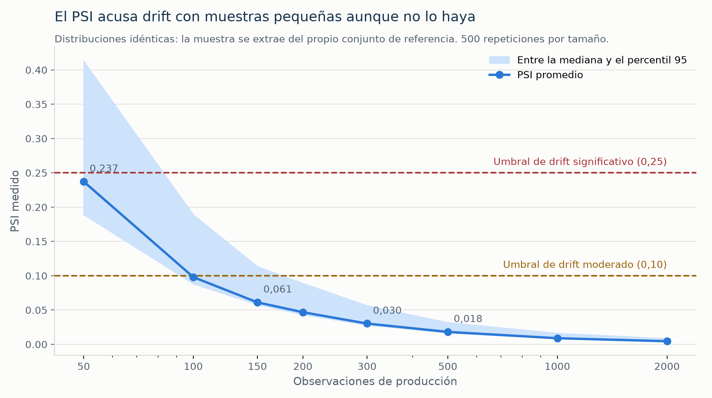

# S5-A4 — Calibración del sistema de monitoreo

Issue #117. Justifica con datos los parámetros del detector de drift: por qué
esos umbrales, cuánta muestra hace falta para que signifiquen algo y por qué
el escenario de control se rediseñó a mitad del Sprint 3.

Las tres calibraciones las produce `scripts/calibrar_monitoreo.py`, que usa
`calcular_psi` y `clasificar_nivel` del propio detector: lo que se calibra es
el sistema, no una reimplementación. Semilla fija 42, conjunto de referencia
de 7032 registros del caso de uso de churn.

```powershell
python -m scripts.calibrar_monitoreo
python docs/figuras/sprint5/render_calibracion.py
```

## 1. Sensibilidad: el detector responde en proporción al cambio

Se altera `TotalCharges` de una muestra de 1000 registros por factores
crecientes y se mide qué PSI acusa el detector.

| Factor | PSI | Nivel | ¿Genera alerta? |
|---:|---:|---|---|
| 1,0 | 0,0092 | bajo | no |
| 1,1 | 0,0235 | bajo | no |
| 1,2 | 0,0538 | bajo | no |
| 1,3 | 0,1092 | medio | sí |
| 1,5 | 0,1932 | medio | sí |
| 1,8 | 0,3397 | alto | sí |
| 2,0 | 0,4237 | alto | sí |
| 2,5 | 0,6081 | alto | sí |

El PSI crece de forma monótona con la magnitud de la alteración y los niveles
escalan en el orden esperado. Dos lecturas útiles para la defensa:

- **El detector no es hipersensible.** Un aumento del 20 % en la facturación
  total no dispara alerta: PSI 0,0538, nivel bajo. Hace falta un 30 % para
  cruzar el umbral moderado.
- **El umbral alto exige un desplazamiento grande.** Se alcanza alrededor del
  factor 1,8, es decir casi el doble de la facturación original.

Sin esta tabla, los umbrales 0,10 y 0,25 serían dos números tomados de la
escala estándar del PSI. Con ella se sabe a qué magnitud de cambio real
corresponden en este dataset.

## 2. Sesgo por tamaño de muestra: el hallazgo



**Figura 26.** PSI medido cuando las dos distribuciones son la misma. Fuente:
elaboración propia con `scripts/calibrar_monitoreo.py`.

Se extraen muestras del propio conjunto de referencia —de modo que **no hay
drift que detectar**— y se mide el PSI. Idealmente debería dar cero. No lo
da: el índice tiene un sesgo positivo que depende del tamaño de la muestra.

| Observaciones | PSI promedio | Mediana | Percentil 95 | Supera 0,10 | Supera 0,25 |
|---:|---:|---:|---:|---:|---:|
| 50 | 0,2373 | 0,1892 | 0,4130 | 85,4 % | 27,4 % |
| 100 | 0,0980 | 0,0882 | 0,1889 | 40,8 % | 1,6 % |
| 150 | 0,0612 | 0,0579 | 0,1135 | 9,4 % | 0,0 % |
| 200 | 0,0468 | 0,0433 | 0,0891 | 2,2 % | 0,0 % |
| 300 | 0,0303 | 0,0281 | 0,0565 | 0,0 % | 0,0 % |
| 500 | 0,0181 | 0,0167 | 0,0319 | 0,0 % | 0,0 % |
| 1000 | 0,0089 | 0,0083 | 0,0163 | 0,0 % | 0,0 % |
| 2000 | 0,0045 | 0,0042 | 0,0085 | 0,0 % | 0,0 % |

Qué dice esta tabla:

- **Con 50 observaciones el detector es inservible.** El PSI promedio es
  0,2373, a un paso del umbral alto, y en el 27 % de los casos lo cruza. Una
  alerta de drift significativo con esa muestra no informa de nada.
- **Con 150 el ruido todavía manda.** Promedio 0,0612 y una de cada diez
  mediciones supera el umbral moderado solo por azar.
- **Desde 300 el sesgo deja de importar.** Promedio 0,0303 y ninguna de las
  500 repeticiones alcanza 0,10. A partir de ahí, una alerta significa algo.

La razón es conocida: el PSI compara frecuencias en diez intervalos, y con
pocas observaciones las frecuencias por intervalo fluctúan mucho. Cada
desviación, en cualquier dirección, suma al índice; ninguna lo resta. El
sesgo es por tanto siempre positivo.

### Consecuencia para el proyecto

El detector exige hoy un mínimo de 30 registros (`MINIMO_REGISTROS` en
`src/monitoring/detect_drift.py`). Ese valor es el **mínimo técnico**: por
debajo, el cálculo no tiene sentido. La calibración muestra que el **volumen
estadísticamente defendible es otro**: a partir de 300 observaciones, y con
500 el margen es cómodo.

Esa distinción conviene hacerla explícita antes que esconderla: el sistema
calcula desde 30 registros, pero una alerta emitida con menos de 300 debe
leerse como indicio y no como evidencia. Elevar `MINIMO_REGISTROS` a 300
queda propuesto como trabajo futuro, porque el Sprint 5 no abre el código.

## 3. El rediseño del escenario de control

El escenario de control debía producir datos **sin** drift, para comprobar
que el detector no alerta cuando no debe. La primera versión del generador de
tráfico sorteaba cada variable dentro de rangos plausibles con distribución
uniforme: `tenure` entre 1 y 72, cargo mensual entre 20 y 120, y la
facturación total como producto de ambos.

El detector marcó drift alto. La reacción natural fue sospechar del detector;
al revisarlo, resultó que tenía razón. Un conjunto de clientes uniformemente
repartidos no se parece a la clientela real, donde la antigüedad se concentra
en los extremos y la facturación sigue una distribución muy sesgada.

La comprobación, con el mismo detector:

| Escenario de control | tenure | MonthlyCharges | TotalCharges |
|---|---:|---:|---:|
| Valores uniformes (diseño original) | 0,3389 **alto** | 1,2488 **alto** | 0,3697 **alto** |
| Muestreado del baseline (diseño actual) | 0,0034 bajo | 0,0048 bajo | 0,0048 bajo |

El PSI de 1,2488 en `MonthlyCharges` no deja lugar a dudas: la distribución
uniforme y la real son dos poblaciones distintas. El escenario se rediseñó
para muestrear clientes del propio conjunto de referencia, y desde entonces
el control da valores de 0,003 a 0,005, como corresponde.

El cambio está en el historial: el generador original se incorporó en
`fbefc36` y se reescribió después para muestrear del baseline, con el
parámetro `factor_drift` que permite provocar la desviación de forma
controlada cuando lo que se quiere probar es el otro escenario.

### Por qué este episodio vale más que el resultado

Demuestra dos cosas a la vez. Que el detector es sensible de verdad, porque
encontró una diferencia que el equipo no había visto. Y que **el diseño del
escenario de control importa tanto como el del escenario de drift**: una
prueba de control mal construida no valida nada, y además habría llevado a
ajustar los umbrales hacia arriba para "corregir" un falso positivo que no
era tal.

## Resumen de los parámetros y su justificación

| Parámetro | Valor | En qué se apoya |
|---|---|---|
| Umbral moderado | 0,10 | Escala estándar del PSI; corresponde a un desplazamiento cercano al 30 % en la variable (tabla 1) |
| Umbral significativo | 0,25 | Escala estándar; corresponde a un desplazamiento cercano al 80 % (tabla 1) |
| Mínimo técnico | 30 registros | Por debajo el cálculo no es interpretable |
| Volumen defendible | 300 registros | Desde ahí el sesgo del índice no cruza el umbral moderado en 500 repeticiones (tabla 2) |
| Variables vigiladas | `tenure`, `MonthlyCharges`, `TotalCharges` | Las numéricas del dataset; las categóricas no admiten PSI sin binarizar |
| Intervalos del PSI | 10, por cuantiles de la referencia | Convención habitual; con menos observaciones por intervalo el sesgo crece |

## Evidencia

| Archivo | Contenido |
|---|---|
| `evidencias/sprint5/calibracion_sensibilidad.csv` | PSI y nivel por factor de alteración |
| `evidencias/sprint5/calibracion_tamano_muestra.csv` | Sesgo del PSI por tamaño de muestra, 500 repeticiones |
| `evidencias/sprint5/calibracion_escenario_control.csv` | PSI de los dos diseños del escenario de control |
| `figuras/sprint5/figura-26-sesgo-psi-muestra.png` | Figura 26 |

## Límites de esta calibración

Se hizo sobre el caso de uso de churn y su conjunto de referencia. El sesgo
por tamaño de muestra es una propiedad del índice y se espera en cualquier
dataset, pero las magnitudes concretas —cuánto PSI produce cada factor de
alteración, a partir de qué volumen se estabiliza— dependen de la forma de
las distribuciones y deben recalcularse para fraude cuando ese caso tenga
tráfico propio.
