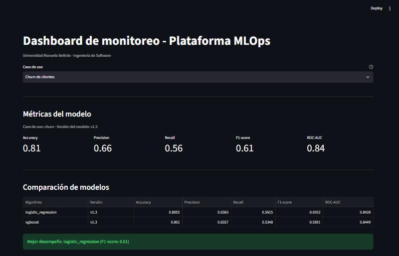
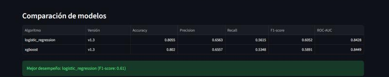
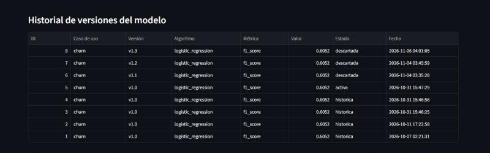
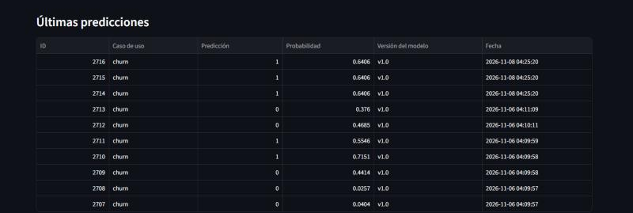
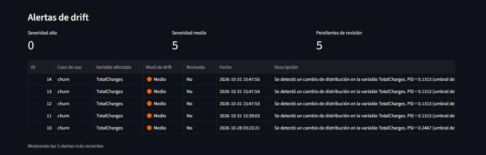
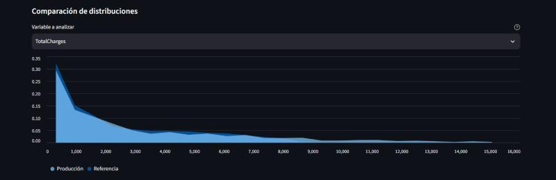
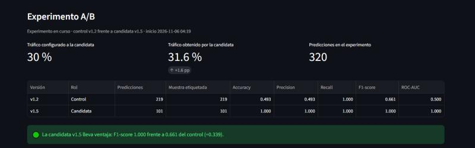
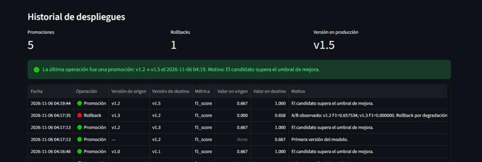
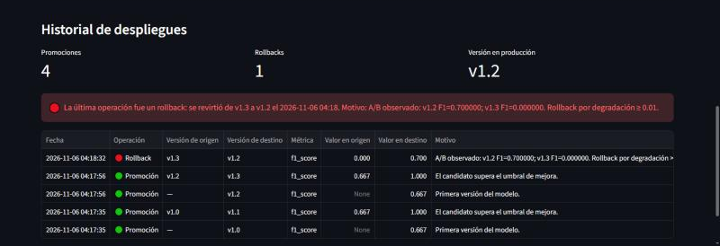

# S5-A5 — Manual de usuario del dashboard

Issue #118. Guía para quien opera la plataforma. Recorre las siete secciones
del tablero explicando qué muestra cada una, cómo se lee y qué hacer con lo
que dice.

No hace falta conocer el código para usarlo. Sí hace falta saber qué decisión
toca en cada caso, y eso es lo que este manual intenta dejar claro.

## Abrir el dashboard

Con la plataforma levantada (`docker compose up -d`), el tablero está en
**http://localhost:8501**.

Lee directamente de PostgreSQL y **no se actualiza solo**: muestra el estado
del momento en que se cargó la página. Para ver datos nuevos hay que recargar
(F5). Si acaba de ejecutarse el pipeline o de generarse tráfico, recargar es
el primer paso.

## Selector de caso de uso

Lo primero del tablero. Todo lo que aparece debajo corresponde al caso
seleccionado: churn o fraude. Si una sección aparece vacía, lo primero que
hay que comprobar es si el selector está en el caso de uso correcto.

## 1. Métricas del modelo

**Qué muestra.** Las cinco métricas de evaluación de la versión activa:
accuracy, precision, recall, F1-score y ROC-AUC, con el caso de uso y la
versión en el encabezado.

**Cómo se lee.** Son las métricas del conjunto de prueba, calculadas cuando
se entrenó esa versión. **No son el desempeño en producción**: para eso está
la sección de experimento A/B, que las calcula sobre predicciones reales con
etiqueta conocida.

En este proyecto la métrica de decisión es el **F1-score**, porque las clases
están desbalanceadas y la accuracy sola sería engañosa: un modelo que
predijera "no abandona" siempre acertaría cerca del 73 % de las veces sin
servir para nada.

**Qué hacer.** Nada por sí sola. Es el punto de partida para comparar.

## 2. Comparación de modelos

**Qué muestra.** Las métricas de los dos algoritmos que el pipeline entrena,
Logistic Regression y XGBoost, y debajo un aviso con el de mejor desempeño
según F1.

**Cómo se lee.** Sirve para responder si se eligió el algoritmo correcto. Es
normal que un algoritmo gane en una métrica y pierda en otra: en este
proyecto la regresión logística supera a XGBoost en F1 mientras XGBoost
obtiene mejor ROC-AUC, lo que indica que el umbral de decisión no está
optimizado. Ese hallazgo está discutido en la documentación de S5-J1.

**Qué hacer.** Si el algoritmo ganador cambia entre versiones, conviene
revisar si el cambio es real o producto del azar del reentrenamiento. Una
diferencia de milésimas no justifica cambiar de algoritmo.

## 3. Historial de versiones del modelo

**Qué muestra.** Todas las versiones registradas con su algoritmo, su métrica
y su estado, más una gráfica de la evolución de la métrica principal.

**Cómo se lee.** Los estados son tres y conviene no confundirlos:

| Estado | Significado |
|---|---|
| `activa` | Es la que está sirviendo predicciones ahora. Solo puede haber una por caso de uso |
| `historica` | Estuvo activa y fue reemplazada |
| `descartada` | Se entrenó y no superó el umbral de mejora; nunca sirvió tráfico |

**Qué hacer.** Si ve varias versiones `descartada` seguidas, el modelo dejó
de mejorar con los datos actuales: reentrenar otra vez no va a cambiarlo.
Lo que corresponde entonces es revisar los datos o el enfoque, no repetir el
pipeline.

## 4. Últimas predicciones

**Qué muestra.** Las diez predicciones más recientes con su resultado, la
probabilidad asociada, la versión que las atendió y la fecha.

**Cómo se lee.** Es la comprobación rápida de que la API está viva y de que
está sirviendo la versión que usted espera. La columna **Versión del modelo**
es la más informativa: si aparece una versión distinta a la activa, hay un
experimento A/B en curso repartiendo el tráfico.

La probabilidad permite ver si el modelo está decidiendo con convicción o
cerca del umbral. Muchas probabilidades alrededor de 0,5 indican casos
ambiguos para el modelo.

**Qué hacer.** Si la tabla está vacía habiendo tráfico, el problema está en
la escritura a la base, no en el modelo. Revise los logs de la API con
`docker compose logs api`.

## 5. Alertas de drift

**Qué muestra.** Tres indicadores —alertas de severidad alta, de severidad
media y pendientes de revisión— y la tabla de las alertas con la variable
afectada, su nivel, el PSI medido y la fecha. Si hay alguna alerta alta sin
revisar, aparece además un aviso destacado en rojo.

**Cómo se lee.** Una alerta significa que la distribución de una variable en
producción se alejó de la que tenía el modelo al entrenarse. El nivel sale
del PSI:

| Nivel | PSI | Qué significa |
|---|---|---|
| 🟢 Bajo | menor a 0,10 | Variación normal. No genera alerta |
| 🟠 Medio | entre 0,10 y 0,25 | La distribución se movió. Vigilar |
| 🔴 Alto | 0,25 o más | Cambio sustancial. El modelo opera sobre datos distintos a los que aprendió |

**Antes de reaccionar, mire el volumen.** El PSI exagera con muestras
pequeñas: con 150 predicciones mide 0,06 en promedio aunque no haya ningún
cambio, y supera 0,10 una de cada diez veces solo por azar. Una alerta media
calculada sobre menos de 300 predicciones es un indicio, no una conclusión.
El detalle está en la documentación de calibración, S5-A4.

**Qué hacer según el caso:**

| Situación | Acción |
|---|---|
| Alerta **media** con menos de 300 predicciones | Esperar a acumular volumen y volver a ejecutar la detección |
| Alerta **media** con volumen suficiente | Revisar la comparación de distribuciones y vigilar la evolución. No reentrenar todavía |
| Alerta **alta** en una variable | Comparar las distribuciones, confirmar que el cambio es real y preparar un reentrenamiento |
| Alerta **alta** en varias variables a la vez | Sospechar primero de la fuente de datos: un cambio simultáneo suele ser un problema de integración, no del negocio |
| Alertas que se repiten idénticas | Son ejecuciones sucesivas del detector sobre los mismos datos. Marcar como revisadas las ya atendidas |

Reentrenar no es la respuesta automática al drift. Si la distribución cambió
porque el negocio cambió, el modelo nuevo aprenderá la realidad nueva. Si
cambió porque se rompió una integración, reentrenar fija el error dentro del
modelo.

## 6. Comparación de distribuciones

**Qué muestra.** Para la variable que se elija, la distribución del conjunto
de referencia y la de los datos de producción, superpuestas y expresadas como
proporción para que sean comparables aunque tengan distinto tamaño. El
selector lista primero las variables que generaron alertas.

**Cómo se lee.** Es la explicación visual de la alerta. Dos formas distintas
de diferir, con lecturas distintas:

- **La curva de producción está desplazada** respecto a la de referencia: los
  valores se movieron en bloque. Suele ser un cambio real del negocio, como
  un aumento de tarifas.
- **La curva tiene otra forma**, con picos donde la referencia no los tiene:
  suele indicar un problema de datos, como valores por defecto que llegan
  repetidos.

**Qué hacer.** Si el gráfico no muestra diferencia apreciable y aun así hay
alerta, es probable que sea el sesgo por muestra pequeña. Compruebe cuántas
predicciones hay acumuladas antes de actuar.

## 7. Experimento A/B

**Qué muestra.** Con un experimento en curso: las dos versiones comparadas,
el tráfico configurado para la candidata frente al obtenido, el número de
predicciones del experimento, el desempeño real de cada grupo con su muestra
etiquetada, y un aviso de color con la versión que lleva ventaja. Sin
experimento activo, informa el último resultado conocido.

**Cómo se lee.** Esta es la única sección que muestra desempeño **real en
producción**, calculado sobre predicciones cuya etiqueta verdadera se conoce.
Los tres indicadores superiores se leen así:

- **Tráfico configurado frente al obtenido.** Una diferencia de pocos puntos
  es normal: el reparto se sortea por petición. Una diferencia grande indica
  que el experimento arrancó sobre una versión que ya venía atendiendo
  tráfico, o que el volumen todavía es bajo.
- **Muestra etiquetada.** Es la cifra que decide si el resultado vale. El
  tablero exige 30 predicciones etiquetadas por grupo antes de declarar
  ventaja.

El aviso de color resume la conclusión:

| Color | Significado | Acción |
|---|---|---|
| 🟢 Verde | La candidata supera al control en F1 | Puede promoverse al cerrar el experimento |
| 🔴 Rojo | La candidata va por debajo | Cerrar el experimento: el sistema revertirá a la versión de control |
| 🟠 Naranja | Muestra insuficiente | Dejar correr el experimento. Ninguna conclusión todavía |

**Qué hacer.** No cerrar un experimento mientras el aviso esté en naranja, y
no promover por diferencias mínimas: una ventaja de milésimas sobre pocas
decenas de predicciones no distingue el mérito del azar.

## 8. Historial de despliegues

**Qué muestra.** Cuántas promociones y rollbacks se han hecho, qué versión
está en producción, y la bitácora cronológica con la operación, las dos
versiones involucradas, la métrica de cada una y el motivo. La última
operación aparece destacada: en verde si fue una promoción, en rojo si fue un
rollback.

**Cómo se lee.** Es el registro de qué estuvo sirviendo y por qué dejó de
hacerlo. El campo **Motivo** es el que responde la pregunta importante: dice
si la versión entró por superar el umbral de mejora o si salió por
degradación medida.

**Qué hacer.** Un rollback registrado no requiere acción: el sistema ya
revirtió y la API sirve la versión anterior sin intervención. Lo que sí
corresponde es investigar por qué la candidata se degradó antes de volver a
promoverla.

Si ve varios rollbacks seguidos sobre la misma versión, deténgase: algo
sistemático está fallando en el entrenamiento o en los datos, y repetir el
ciclo solo repetirá el resultado.

## Caso de uso de fraude

Las ocho secciones funcionan igual para fraude; cambian los datos y las
variables vigiladas, que para ese caso son `Time` y `Amount`. Si al
seleccionarlo las secciones aparecen vacías, es que todavía no hay versiones
ni tráfico registrados para ese caso de uso, no que el tablero falle.

## Preguntas frecuentes del operador

**El dashboard muestra datos viejos.** Recargue la página. El tablero no se
actualiza solo.

**Una sección dice que no hay datos.** Compruebe el selector de caso de uso.
Si es el correcto, esa tabla está vacía en la base: ejecute el pipeline, el
tráfico o la detección de drift según la sección.

**La versión en producción del historial de despliegues no coincide con la
del historial de versiones.** El historial de despliegues muestra el destino
de la última operación registrada. Si alguien cambió estados a mano en la
base sin registrar el despliegue, ambas vistas pueden discrepar. La fuente de
verdad para la API es `model_versions`.

**El dashboard no abre.** Compruebe que el contenedor está arriba con
`docker compose ps` y, si acaba de cambiar código de `src/`, reinícielo:
Streamlit recarga el script pero conserva en memoria los módulos importados.
