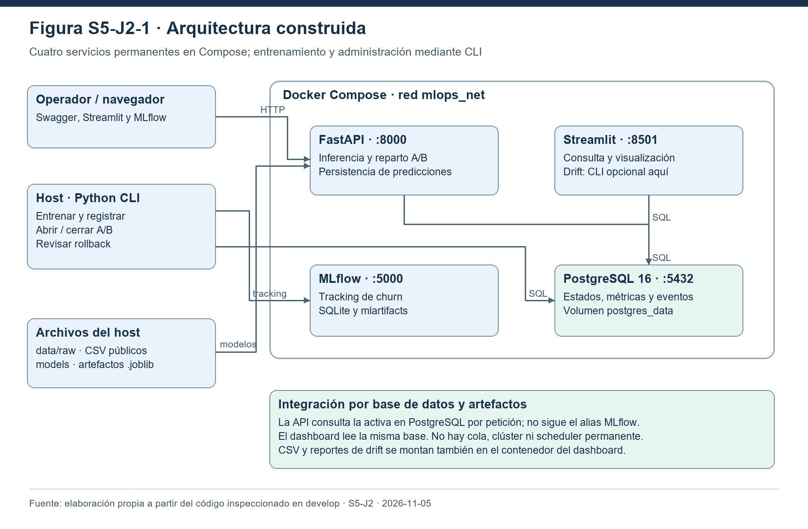
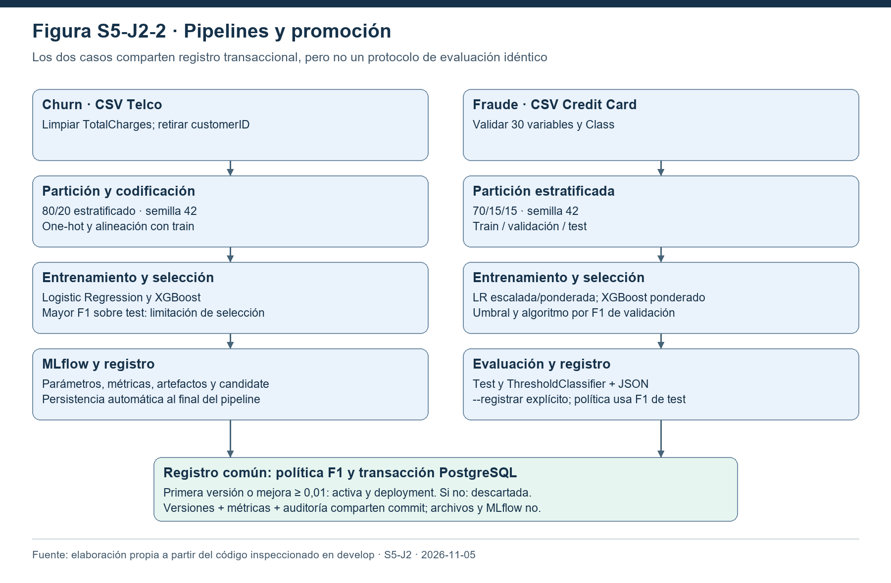
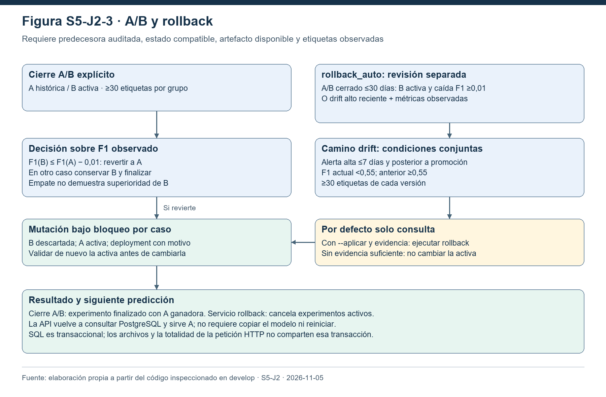
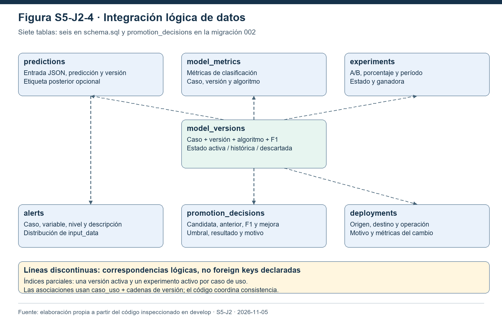

# S5-J2 — Arquitectura técnica de Sistema-MLOps

**Responsable:** Joseph. **Issue:** [#111](https://github.com/Allan-Romero/Sistema-MLOps/issues/111).
**Fecha de inspección:** 5 de noviembre de 2026, Colombia.
**Base técnica inspeccionada:** `develop`, commit `f245128`, que integra los PR #106, #107, #108 y #109. Esta descripción no afirma que esos cambios estén en `main` ni que el documento académico haya sido aprobado por el asesor.

El sistema implementa dos clasificadores binarios sobre datos tabulares: abandono de clientes (`churn`) y fraude en transacciones (`fraude`). Gestiona entrenamiento, artefactos, selección operativa de versiones, inferencia HTTP, registro de predicciones, monitoreo de distribución y consulta de resultados. Las decisiones se apoyan en datos de PostgreSQL y artefactos `joblib`; MLflow cumple un papel de seguimiento del entrenamiento de churn y mantiene su propio registro.

## 1. Despliegue construido

**Figura S5-J2-1.** Componentes del despliegue local. Fuente: elaboración propia a partir de `docker-compose.yml` y de los módulos de API, entrenamiento y monitoreo. La línea discontinua representa ejecución CLI opcional del detector dentro del contenedor del dashboard; no un proceso periódico instalado. [Fuente Mermaid](figuras/sprint5/arquitectura.mmd).

| Componente | Ejecución y almacenamiento | Responsabilidad y contratos |
|---|---|---|
| PostgreSQL 16 | Servicio `postgres`, puerto local 5432, volumen `postgres_data` | Versiones, métricas, predicciones, etiquetas, experimentos, decisiones de promoción, alertas e historial de despliegues. Es el punto de integración operativo. |
| FastAPI / Uvicorn | Servicio `api`, puerto 8000, usuario sin privilegios | Valida las entradas, consulta la versión o el experimento, carga el artefacto, predice y persiste el resultado. Monta `src/` y `models/`; los modelos son de solo lectura en el Compose habitual. |
| Streamlit | Servicio `dashboard`, puerto 8501 | Consulta PostgreSQL por caso de uso y representa métricas, versiones, predicciones, alertas, A/B y despliegues. Monta `dashboard/`, `src/`, `data/` de solo lectura y `reports/` escribible. |
| MLflow | Servicio `mlflow`, puerto 5000; SQLite `mlflow.db` y `mlartifacts/` montados desde el host | Registra parámetros, métricas y artefactos del pipeline de churn. El servidor MLflow es independiente del esquema PostgreSQL del producto. |
| Python en el host | CLI en el entorno virtual; acceso a `data/`, `models/`, `reports/` y los puertos publicados | Entrenamiento completo, registro de candidatos, apertura/cierre de A/B y revisiones de rollback. No existe un quinto contenedor permanente de entrenamiento. |

La red `mlops_net` permite resolver los servicios por sus nombres. La API y el dashboard usan `POSTGRES_HOST=postgres`; los comandos del host usan por defecto `localhost`. Las credenciales provienen del entorno o de `.env`, no se incluyen aquí. API y dashboard esperan el healthcheck de PostgreSQL. El Compose de desarrollo ejecuta Uvicorn con `--reload`; no representa una configuración endurecida de producción.

### Persistencia y separación de responsabilidades

- **PostgreSQL:** verdad operativa sobre qué versión está activa y qué experimento está vigente. La API no toma la versión activa del alias MLflow.
- **`models/`:** artefactos versionados con nombre `<caso_uso>_model_<version>.joblib`. El registro crea una copia inmutable por versión; los archivos intermedios de entrenamiento sí se reutilizan.
- **MLflow:** experimentos y registro de churn; su numeración y sus alias no están sincronizados transaccionalmente con PostgreSQL. El flujo de fraude inspeccionado guarda reporte JSON y registra PostgreSQL, sin una etapa equivalente de tracking en MLflow.
- **`reports/`:** reportes de fraude y drift generados. Su existencia o la disponibilidad de la interfaz no prueban por sí solas validez científica.

La API y Streamlit se integran mediante PostgreSQL; la pantalla no necesita invocar `/predict` para mostrar resultados históricos. La base también introduce un punto único de dependencia: si PostgreSQL deja de estar disponible, se afectan inferencia y visualización. No se implementan cola de eventos, balanceador, Kubernetes ni alta disponibilidad.

## 2. Flujo de inferencia de extremo a extremo

1. El cliente envía JSON a `POST /predict` (19 variables de churn) o `POST /predict-fraud` (`Time`, `V1`…`V28`, `Amount`). Pydantic valida el contrato. En fraude se prohíben columnas adicionales, incluida `Class`; la etiqueta verdadera no entra como predictor.
2. La API consulta `experiments` para el caso correspondiente. Sin experimento activo, consulta `model_versions` con estado `activa`. Con experimento, `seleccionar_version_ab` sortea un valor independiente por solicitud y asigna grupo A/B de acuerdo con `porcentaje_trafico_b`.
3. El cargador valida caso y versión antes de construir una ruta. El cargador A/B también verifica el estado y, para el modo pospromoción, la pareja auditada. No admite una versión `descartada`.
4. El archivo se carga con `joblib.load`; una caché LRU de hasta diez rutas evita recargar cada artefacto en cada solicitud. La consulta a PostgreSQL sí ocurre en cada predicción, de manera que una nueva activa se ve sin reiniciar Uvicorn.
5. Churn aplica `get_dummies` a la entrada y alinea columnas con `feature_names_in_` del modelo. Fraude construye el DataFrame de las 30 variables en el orden de `FEATURE_COLUMNS`. El adaptador de fraude conserva el umbral seleccionado durante validación.
6. Se ejecutan `predict` y `predict_proba`. Se persisten caso, entrada JSON, clase, probabilidad y versión en `predictions`. La respuesta incorpora la predicción, su probabilidad, la versión utilizada y `prediction_id`. Churn añade `experiment_id` y `ab_group` cuando corresponde; fraude no expone esos dos campos, aunque persiste la versión que atendió.
7. Cuando se conoce una etiqueta, `registrar_etiqueta_real` actualiza `etiqueta_real` y su fecha. Hasta entonces la predicción no participa en los cálculos observados de F1.
8. El dashboard consulta esos registros y los presenta al seleccionar el caso de uso y recargar la vista.

**Salud frente a preparación:** `/health` devuelve el estado del proceso y la última versión de churn cargada en sus variables globales. La carga es diferida. No comprueba de forma completa el acceso a PostgreSQL, la existencia de una activa o el buen funcionamiento del modelo de fraude. El E2E incluye predicciones reales para cubrir esas dependencias, además del healthcheck.

**Errores relevantes:** los cargadores traducen problemas de consulta/artefacto a 503, ausencia de versión a 404 y estados A/B incompatibles a 409; Pydantic responde 422 ante entradas inválidas. No todos los errores se normalizan: por ejemplo, un estimador incompatible o una excepción de persistencia en churn puede producir 500. La documentación no atribuye al sistema tolerancia a fallos total.

Fuentes: `src/api/main.py`, `fraud.py`, `model_loader.py`, `ab_models.py`, `ab_routing.py`, `src/database/crud.py` y `src/training/fraud_model.py`.

## 3. Entrenamiento, evaluación y registro

**Figura S5-J2-2.** Entrenamiento y política operativa de registro de churn y fraude. Fuente: elaboración propia a partir de `run_pipeline.py`, `preprocess.py`, `fraud_pipeline.py`, `select_best_model.py` y `model_promotion.py`. [Fuente Mermaid](figuras/sprint5/pipeline.mmd).

### Churn

`python -m src.training.run_pipeline` encadena ocho etapas: preprocesamiento; entrenamiento de regresión logística; evaluación de esta; entrenamiento de XGBoost; comparación; selección por mayor F1; registro de experimentos en MLflow; y persistencia en PostgreSQL.

El preprocesamiento convierte `TotalCharges`, elimina `customerID`, codifica `Churn` y hace una partición estratificada 80/20 con semilla 42. Las columnas categóricas se identifican en entrenamiento y las columnas de prueba se alinean con las de entrenamiento. Se generan CSV procesados y artefactos locales.

En la implementación histórica inspeccionada, la comparación y selección usan el mismo conjunto de prueba. Esto limita su interpretación como evaluación independiente: el test interviene en la elección. No se debe describir este camino como selección exclusivamente por validación ni extrapolar una superioridad científica a partir de una única partición. La comparación final y cualquier ajuste metodológico del Sprint 5 deben leerse junto con el reporte de S5-J1.

MLflow registra una ejecución por algoritmo y crea versión/alias `candidate` para el seleccionado. Después `persist_results` llama al registro transaccional del sistema; el alias de MLflow no dirige el tráfico de inferencia.

### Fraude

`python -m src.training.pipeline_multicaso --caso-uso fraude` entrena y deja candidato/reporte sin escribir PostgreSQL. Una segunda ejecución con `--registrar` registra ese reporte; no vuelve a entrenar. El pipeline valida el esquema y clases, divide estratificadamente 70/15/15 con semilla 42, usa regresión logística escalada y ponderada, y XGBoost con ponderación de clase.

Cada algoritmo elige el umbral que maximiza F1 sobre validación. Se elige el algoritmo por F1 de validación y, en empate, por average precision. Después se evalúa test. El reporte incluye accuracy, precision, recall, F1, ROC-AUC y average precision (campo `pr_auc`). El candidato es un `ThresholdClassifier` que conserva columnas y umbral. Su SHA-256 se comprueba al registrar para evitar usar un artefacto modificado respecto del reporte.

El algoritmo y umbral se eligen sin test, pero el servicio de registro inspeccionado usa el F1 de test del reporte para decidir promoción. Por tanto, test también influye en la decisión de despliegue, aunque no en la elección del algoritmo. PostgreSQL guarda cinco métricas; average precision queda en JSON. Estas diferencias entre ambos casos deben conservarse en la discusión académica.

### Promoción transaccional compartida

`registrar_candidato` adquiere `pg_advisory_xact_lock` por caso y bloquea las filas activas. Comprueba la unicidad de activa, la métrica, la versión y el archivo. Cuando genera versión automáticamente, consulta las versiones existentes y crea un nuevo archivo sin sobrescribir otro.

| Condición | Resultado operativo |
|---|---|
| No hay activa | Se promueve la primera candidata. |
| F1 candidata − F1 activa ≥ 0,01 | Nueva versión `activa`; anterior `historica`. |
| Mejora inferior a 0,01 | Nueva versión `descartada`; activa sin cambios. |

La versión, las métricas de ambos algoritmos y `promotion_decisions` comparten una transacción. Si se promueve, la misma transacción añade `deployments` con motivo y métricas. El índice parcial impide dos activas por caso. Si falla la operación, se hace rollback SQL y se intenta retirar el nuevo artefacto creado por esa operación.

**Límite de atomicidad:** los archivos y MLflow no participan en la transacción PostgreSQL. La limpieza de archivo ante excepción no cubre todos los escenarios de interrupción del proceso o caída del host. Tampoco el pipeline completo de entrenamiento está protegido por ese bloqueo: dos ejecuciones simultáneas comparten archivos intermedios y no deben tratarse como entrenamiento concurrente seguro.

## 4. Experimentos A/B

El reparto es configurable entre 0 y 100 % para B y se realiza con `random.random` por solicitud. No se promete asignación estable por cliente ni un reparto exactamente 50/50 en una muestra finita. El índice parcial de `experiments` admite un solo experimento activo por caso.

La API contempla dos parejas de estados:

| Modalidad | Grupo A | Grupo B | Creación y cierre |
|---|---|---|---|
| Compatibilidad prepromoción | `activa` | `candidata` | El cargador admite esta configuración. El registro normal promueve o descarta y no genera por sí solo una fila en estado `candidata`. No existe en el CLI de cierre actual una gestión completa de este modo. |
| Pos promoción implementada por `experiment_service` | La predecesora `historica` | La nueva `activa` | `abrir_experimento` deriva la pareja de una promoción auditada; `finalizar_experimento` decide con etiquetas observadas. |

El cargador pospromoción exige que la configuración activa, `promotion_decisions` y los estados de las dos versiones correspondan. No sirve cualquier histórica por el solo hecho de existir en disco.

Al cerrar un A/B pospromoción se toma el mismo bloqueo por caso, se bloquea el experimento, se verifica que B siga activa y que A sea la predecesora histórica auditada. Se calculan F1 con predicciones etiquetadas del caso y versión dentro del período del experimento. Cada grupo necesita al menos 30 etiquetas. Si no se cumplen las condiciones se revierte la transacción y el experimento no se cierra.

- Si F1(B) ≤ F1(A) − 0,01: B pasa a `descartada`, A a `activa`, se registra `rollback` en `deployments` y el experimento finaliza con A ganadora.
- En los demás casos: se conserva B y el experimento finaliza con B. Esto incluye empate y pérdidas menores al margen; **el campo `version_ganadora` no demuestra superioridad estadística**.

El período y la versión son las claves de atribución de observaciones; `predictions` no almacena `experiment_id` como columna. Una llamada concurrente con un cambio de configuración puede terminar de servir una versión que leyó antes del cambio. No se implementa una transacción distribuida que abarque toda la solicitud HTTP.

## 5. Monitoreo y rollback

**Figura S5-J2-3.** Caminos de cierre A/B y revisión de rollback. Fuente: elaboración propia a partir de `experiment_service.py`, `rollback_auto.py`, `rollback_policy.py`, `rollback_observations.py` y `rollback_service.py`. [Fuente Mermaid](figuras/sprint5/rollback.mmd).

### Drift de distribución

`detect_drift` compara cuantiles de referencia y datos registrados en `predictions.input_data`. Usa hasta diez intervalos, extremos infinitos y sustitución `epsilon=1e-6` cuando una proporción es cero. Para columnas con menos de tres cortes únicos devuelve PSI cero: es una limitación a tener en cuenta para referencias degeneradas.

| Regla implementada | Efecto |
|---|---|
| Menos de 30 observaciones actuales | No se ejecuta el análisis. Es mínimo técnico, no garantía estadística. |
| PSI < 0,10 | Nivel bajo, sin alerta persistida. |
| 0,10 ≤ PSI < 0,25 | Nivel medio; puede persistirse alerta. |
| PSI ≥ 0,25 | Nivel alto; puede persistirse alerta. |

Churn monitorea `tenure`, `MonthlyCharges`, `TotalCharges`; fraude `Time`, `Amount`. Evidently genera HTML; la clasificación operativa del nivel la hace la función PSI del proyecto. El CLI separa detección y registro de alertas. La presencia de dependencias de Evidently en el contenedor del dashboard permite ejecutar allí el módulo, pero Streamlit no constituye un scheduler permanente ni dispara por sí solo reentrenamientos.

### Dos caminos de reversión

El cierre A/B explícito descrito arriba aplica la decisión y finaliza el experimento en una transacción. De forma separada, `python -m src.monitoring.rollback_auto --caso-uso churn` inspecciona evidencia y, por defecto, **solo recomienda**. `--aplicar` habilita el servicio de reversión; el scheduler externo es opcional y no se activa por importar un módulo.

La revisión de rollback exige una activa única con una predecesora auditada disponible. Primero busca un A/B finalizado de la pareja en los últimos 30 días; si hay F1 observado en ambos grupos, solicita rollback únicamente con B activa, al menos 30 etiquetas por grupo y caída de al menos 0,01. Si no se activa esa vía, evalúa drift:

- Alerta `alto`, no revisada, posterior a la promoción y de los últimos siete días.
- F1 de la activa observado desde la promoción < 0,55, con al menos 30 etiquetas.
- F1 de la anterior observado hasta la promoción ≥ 0,55, también con al menos 30 etiquetas.

La lectura de métricas de `rollback_observations` limita por defecto a las 1.000 observaciones etiquetadas más recientes; el cierre A/B explícito no aplica ese mismo límite. Una alerta aislada no sustituye las etiquetas ni autoriza una reversión.

El servicio `ejecutar_rollback` valida la autorización de política y su origen, adquiere el bloqueo de caso y revalida la activa esperada para cancelar una decisión obsoleta. Recupera la predecesora desde `promotion_decisions`, comprueba que siga histórica y que exista su archivo, desactiva B antes de activar A y registra `deployments` en la misma transacción. Este camino cancela experimentos activos del caso; el cierre explícito, en cambio, conserva un experimento `finalizado` con ganadora. No es necesario copiar el archivo activo ni reiniciar la API.

## 6. Modelo de datos e invariantes

**Figura S5-J2-4.** Relaciones lógicas del esquema operativo. Fuente: elaboración propia a partir de `src/database/schema.sql` y migraciones 001–003. Las líneas discontinuas expresan correspondencia entre valores; **no representan claves foráneas declaradas**. [Fuente Mermaid](figuras/sprint5/datos.mmd).

El estado final inspeccionado usa **siete tablas**, no solo las seis de `schema.sql`: `promotion_decisions` se incorpora en la migración 002.

| Tabla | Papel en la arquitectura |
|---|---|
| `predictions` | Entradas JSON, predicción, probabilidad, versión y etiqueta posterior. Fuente de desempeño observado y de distribución actual. |
| `model_metrics` | Accuracy, precision, recall, F1 y ROC-AUC por caso, versión y algoritmo. |
| `model_versions` | Catálogo de versiones y estado operativo. |
| `alerts` | Variables afectadas, nivel, descripción y marca de revisión. |
| `deployments` | Bitácora de cambios efectivos de activa por promoción o rollback. |
| `experiments` | Pareja A/B, proporción, estado, ganadora y período. |
| `promotion_decisions` | Decisiones aceptadas o descartadas, F1, mejora, umbral, motivo y predecesora. |

La identidad de versión se coordina por `caso_uso` y la cadena `version`. Hay un índice parcial para una activa por caso, otro para un experimento activo por caso y unicidad de candidata en `promotion_decisions`. No hay foreign keys entre esas tablas ni una restricción única general de `(caso_uso, version)` en `model_versions`; el código de promoción valida duplicados bajo bloqueo, pero escrituras externas podrían violar esas expectativas.

`docker-compose.yml` monta el esquema y las tres migraciones en el directorio de inicialización de PostgreSQL. Se ejecutan al crear un volumen vacío; una base existente requiere aplicar el esquema/migraciones de manera explícita. Reiniciar el servicio no vuelve a migrar automáticamente un volumen poblado.

## 7. Entrega continua y alcance de la validación

GitHub Actions ejecuta `tests`; el job `delivery` depende de su éxito. Construye imágenes de API, dashboard y MLflow, levanta esas tres y PostgreSQL con `docker-compose.ci.yml`, espera healthchecks, ejecuta `e2e_deployment.py` y comprueba Streamlit mediante `check_dashboard.py`/AppTest. Publica logs y resultados como artefactos y retira el entorno efímero.

El Compose de CI no publica puertos al host, usa credencial efímera, base `mlops_ci` y volumen exclusivo de modelos. A diferencia del Compose habitual, ese volumen es escribible por la API para que el proceso de ensayo pueda entrenar y registrar los artefactos desde el mismo contenedor. No despliega a infraestructura externa, no publica imágenes en un registry y no transforma el CLI en reentrenamiento automático.

El E2E usa datos sintéticos con relación controlada entre característica y etiqueta; entrena clasificadores pequeños y recorre mejora y degradación para los dos contratos de API. Valida integración con HTTP y PostgreSQL reales. AppTest comprueba el renderizado y los indicadores del dashboard. Ninguno de ellos representa una medición de beneficio en una organización ni una prueba estadística de superioridad con Telco/Credit Card.

## 8. Trazabilidad y límites de esta entrega

| Afirmación documentada | Fuentes verificables en el repositorio |
|---|---|
| Cuatro contenedores; entrenamiento habitual en host | `docker-compose.yml`, `docker/*.Dockerfile`, `run_pipeline.py`, `pipeline_multicaso.py` |
| Inferencia dinámica y A/B en ambos casos | `src/api/main.py`, `fraud.py`, `model_loader.py`, `ab_models.py`, `ab_routing.py` |
| Promoción y bitácora transaccionales | `src/database/model_promotion.py`, `promotion_policy.py`, migraciones 001 y 002 |
| Cierre A/B y etiquetas observadas | `src/monitoring/experiment_service.py`, `rollback_observations.py`, `src/database/crud.py` |
| Drift y políticas de reversión | `detect_drift.py`, `rollback_policy.py`, `rollback_auto.py`, `rollback_service.py` |
| Comprobación automatizada | `tests/test_promotion_*.py`, `test_model_promotion*.py`, `test_ab_*.py`, `test_rollback_*.py`, `test_experiment_service.py`, `test_e2e_model_contract.py` y scripts de CI |

Esta sección es documentación de la implementación inspeccionada, no un reporte nuevo de ejecución. Los resultados numéricos de algoritmos corresponden a S5-J1; cobertura y omisiones se reportan en S5-J4; el ensayo de reproducción corresponde a S5-J3. No se modifican los cinco objetivos específicos de la versión académica 2026 ni se presume su aprobación formal. Las figuras se identifican como S5-J2-1…4 para evitar sustituir sin revisión la numeración del documento oficial.
